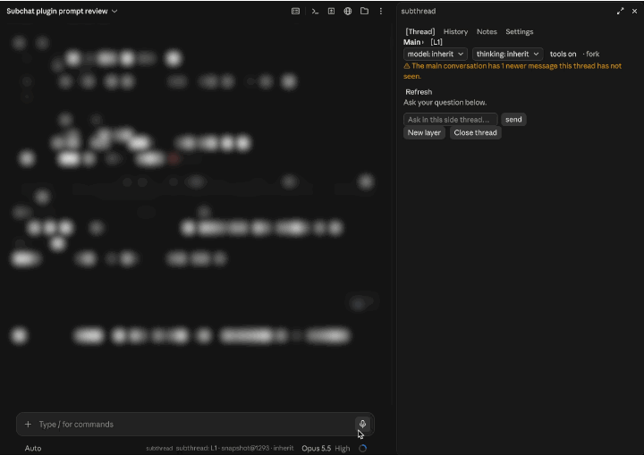

# better-subchat

Ask about any part of a long Claude Code conversation in a side thread that
never enters the main conversation. Where `/btw` is one throwaway question,
better-subchat keeps a chain of nested side threads beside the transcript, lets
them read files and run commands, saves them with the session, and sends an
answer back to the main conversation only when you ask it to.



## Install

> **Renamed in 0.4.0** from `subthread`. If you installed it under the old
> name, remove that first: `claude plugin uninstall subthread@subthread`, then
> `claude plugin marketplace remove subthread`, and install as below. Side
> threads saved under the old name stay in `~/.claude/plugins/data/subthread/`.

At the prompt of a Claude Code terminal session:

```
/plugin install better-subchat --marketplace Libraqg/better-subchat
```

From a shell:

```bash
claude plugin install better-subchat --marketplace Libraqg/better-subchat
```

In the desktop app, where `/plugin` does not run: click **+** next to the
prompt box, then **Plugins**, **Add marketplace** with `Libraqg/better-subchat`, then
**Add plugin**.

Answer `y` to add the marketplace, then pick a scope. The plugin is active at
once; under the user scope it loads in every session after.

**Requires Claude Code 2.1.304 or later** (plugin mods with panes, subagent
spawns and the hooks this plugin uses). Built and tested on 2.1.304 in the
desktop app's Code tab and the fullscreen terminal.

## Trust

A mod runs with your user rights. better-subchat:

- reads the main conversation (`$.session.messages`) to build side-thread
  prompts, and your selection in the fullscreen terminal (`$.ui.selection`);
- answers through your session's own model access: subagents (`$.agent.spawn`:
  a fork of the main conversation, or its own agent types `better-subchat:subchat*`,
  hidden from the main model) and tool-less completions (`$.model.complete`);
- lets those subagents use tools under your normal permission prompts; it never
  approves a tool call for them;
- **in auto mode**, approves one thing itself: starting the subagent for a
  question you just sent, which auto mode cannot rule on. Every tool call that
  subagent makes is still ruled on by auto mode. Turn off `autoModeSpawn` to
  answer without tools in auto mode instead;
- stops its own subagents with `TaskStop` when you press Stop;
- keeps side-thread replies out of the main conversation: its subagents may
  not hand their report back, and any such delivery is dropped;
- adds to your next prompt only what you sent there with **→ Next prompt**
  (backflow, off by default), labelled with its source;
- writes one JSON file per session under `~/.claude/plugins/data/better-subchat/`
  (or `$CLAUDE_PLUGIN_DATA`), and two small preferences (pane language, answer
  view) to its plugin store;
- changes its own settings from the pane through `$.config.set`;
- makes no network request of its own and reads no other file.

## Use

1. Run `/sc` (or `/better-subchat`), optionally with a question: `/sc why does this re-render?`
   In the fullscreen terminal, select text first: it becomes the thread's
   topic. Otherwise a level is labelled by its first question.
2. Ask in the pane. Answers may read files, search and run commands under your
   permissions; tool calls show as one `⚙` line. **Stop** ends an answer.
3. With a thread open, `/sc` brings the pane back. **New layer** (or `/sc new`,
   or `/sc` over a fresh selection in the terminal) opens a deeper level that
   sees every level above it. Click a crumb to read an upper level; closing a
   level closes everything below it. `/sc up` closes the deepest level, `/sc
   close` the thread.
4. Under the crumbs, pick the level's model and thinking effort (or use `/sc
   model haiku` and `/sc effort high`) and turn its tools on or off; the row
   ends with how the next question will be answered. A level on the main model and
   the session's effort runs as a fork of the main conversation, cheapest
   because it reuses the main prompt cache; any other runs as the plugin's own
   subagent and resends the conversation.
5. Answers sit in read-only text fields so you can select and copy them (the
   desktop app lets the mouse select nothing else in a plugin pane); any edit
   is undone.
6. When the main conversation has moved on, a `⚠` line offers **Refresh** (or
   `/sc refresh`): the thread reads the new messages, earlier answers kept.
7. With backflow on, **⋯** under an answer offers **→ Next prompt** (sent along
   with your next main prompt; **↩ Undo** until then), **+ Note** (kept on the
   Notes page, never in the model's context) and, in the terminal, **Copy**.
8. Pages: **History** (`/sc list`) shows the session's closed threads,
   read-only; **Notes**; **Settings** (`/sc settings`) holds how answers are
   drawn, the pane's language (English / 简体中文) and the plugin's settings.

Side threads are saved per session and come back when you resume it; `/clear`
starts a session with none.

## Settings

Set them in the pane's **Settings** page (`/sc settings`) or under `/config`.

| Setting | Default | What it does |
|---|---|---|
| `contextMode` | `snapshot` | `snapshot`: a thread reads the main conversation as it was when it opened, until you refresh. `follow`: every question reads it as it is now. |
| `defaultModel` | `inherit` | Model for new threads: `inherit`, `haiku`, `sonnet`, `opus`, `fable`, or a full model id (tool-less only). |
| `defaultStrategy` | `fork` | `fork`, `agent` or `light` (no tools). |
| `maxDepth` | `5` | Most levels open at once (at least 3). |
| `backflowEnabled` | `false` | Offer Next prompt / Note / Copy under each answer. |
| `autoModeSpawn` | `true` | In auto mode, start a question's subagent; off answers without tools. |
| `language` | `en` | The pane's language until you switch it in the pane. |

## Known limitations

- The desktop app does not expose the selection to plugins: a level is labelled by its first question there.
- Plugin panes cannot make text selectable, so answers are drawn in text fields.
- A fork reads the main conversation as it is now; its snapshot is a request
  ("treat message N as the end"), not a cut. Levels on another model or effort
  send a hard snapshot.
- A subagent can only be named an alias (`sonnet`, `opus`, `haiku`, `fable`);
  a full model id answers without tools.
- In auto mode, a fork that falls back to the plugin's agent (a brand-new
  session with nothing to fork) answers without tools.
- Plugins have no clipboard in the desktop app, so **Copy** is offered in the terminal only: select the answer and press Cmd+C.
- Stopping a tool-less answer stops generation; tokens already sent are billed.
- After the main conversation is compacted, message numbers shift: refresh.
- The mobile app draws the pane read-only.
- Should a side-thread delivery ever reach the main conversation, Claude Code
  shows "A hook blocked your prompt" when better-subchat drops it.

## Contributing

Issues and pull requests are welcome.

- `core/` is plain TypeScript with no `claude-code` import: data model, chain
  transitions, prompt assembly, strategy, views and strings. `hooks/` is the
  Claude Code adapter. Keep harness details out of `core/`.
- Run the plugin from a checkout with `claude --plugin-dir <path-to-better-subchat>`
  (or `CLAUDE_CODE_PLUGIN_DIRS`, for the desktop app).
- `scripts/check.sh` runs `claude plugin validate`, the core purity check,
  `tsc` (needs Node) and `claude plugin test`. All must pass before a release.
- Releases: bump `version` in `.claude-plugin/plugin.json`, date the
  CHANGELOG entry, then `scripts/release.sh vX.Y.Z` checks everything and prints
  the tag and `gh release` commands to run.

## License

MIT
